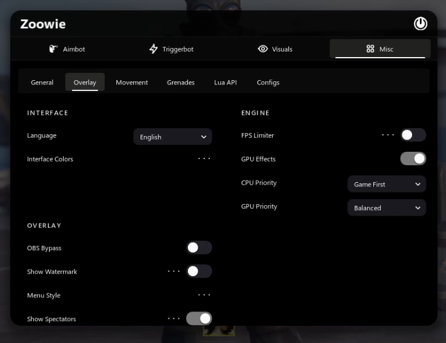

# Zoowie External

External CS2 cheat (clean version, no skinchanger/DLL injection).



## Build

```bat
cmake --preset release -DCMAKE_POLICY_VERSION_MINIMUM=3.5
cmake --build --preset release
```

Output: `build/bin/zoowie_external.exe`

## Config

`Default.cfg` included as a baseline config.
